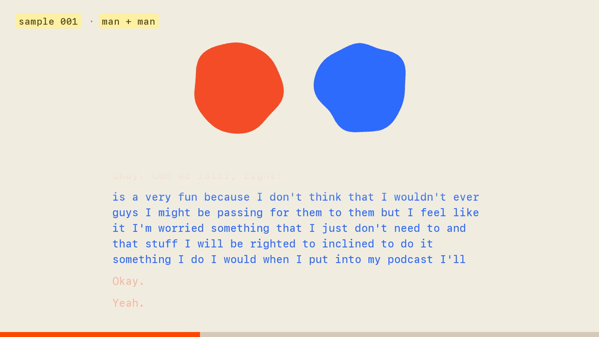
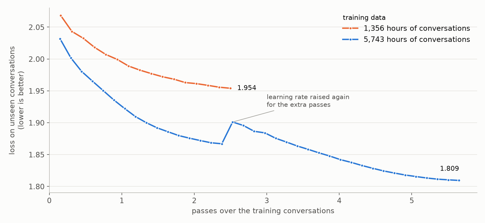

# caramel, a conversation model trained *only* on speech
*10 November 2026*

Model: [huggingface.co/naklecha/caramel-1](https://huggingface.co/naklecha/caramel-1)

I trained a speech-to-speech model inspired by [Dessa](https://block.xyz/dessa). I'm calling the model `caramel-1`. The model learned from recordings of people talking and nothing else, and **has never seen a single word of text**. The code, the training recipe and the weights are open source.

`caramel-1` sounds incredibly human. Most of what `caramel-1` says doesn't make sense yet, but the sentences make a little more sense every time I add more data.

**Two copies of the same model can talk to each other in real time**. Every 80 ms, each copy listens to the other and decides whether to speak or stay quiet. `caramel-1` generates audio about 11 times faster than real time on a GPU, so it's fast enough to talk to a person live. It even keeps up on my MacBook Pro (M3 Pro), where both copies together run about 4 times faster than real time.

[](https://naklecha.com/research/caramel-1)
*Watch and listen to the samples at [naklecha.com/research/caramel-1](https://naklecha.com/research/caramel-1). Two copies of `caramel-1` talk to each other in real time; the transcripts come from a speech recogniser and are only there so you can follow along.*

**[▶ Watch all sixteen samples in one video](https://github.com/naklecha/caramel/blob/main/docs/caramel_samples.mp4)** (16 minutes).

## scoring conversations
I started by measuring Dessa's example conversations. I measured 13 statistics on them and turned each one into a target band. Most of the statistics are about timing, like how much people overlap, how long the gaps between turns are and how many backchannels (the "mm-hm"s people make while someone else talks) there are per minute. The rest are about the recording, like cross-talk between the two tracks and the noise floor. A conversation's closeness score is how far its statistics sit outside those bands, averaged, so **0 means the conversation looks like Dessa on every statistic**.

I also ran the score on conversations I broke on purpose, to make sure it catches bad ones. I shifted one speaker by 5 seconds, swapped one speaker with someone from another conversation, played conversations backwards, put the same track on both sides and replaced the audio with random tokens. Real conversations scored close to 0 and **every broken version scored clearly worse**.

I used closeness to pick which data to download, and later to score `caramel-1`.

## data
Some sources were a lot closer to Dessa than others, so I only downloaded the close ones at scale. All the data is public speech from the internet. About 6,500 hours is two people talking (podcasts, interviews and other recorded conversations) and about 5,800 hours is one person talking (audiobooks and talks).

I went through **66,824 podcast feeds and 3,216 Creative Commons YouTube channels**, and the downloaders pulled about 5,400 hours of audio per hour.

In every conversation each person has to be on their own track. With separate tracks the model can learn both sides of a conversation, including the parts where people talk over each other. Most recordings mix both people into one track, so a separate step splits each recording into one track per speaker. I tested that step on recordings that already had separate tracks before running it on everything else.

## tokens
`caramel-1` never touches raw audio. A neural audio codec turns each speaker's audio into 12.5 frames a second with 8 tokens per frame, so one hour of one person talking is

$$12.5\ \tfrac{\text{frames}}{\text{s}} \times 8\ \tfrac{\text{tokens}}{\text{frame}} \times 3600\ \text{s} = 360{,}000\ \text{tokens}$$

and an hour of a two-person conversation is twice that.

| | hours | unique tokens |
| ------------------------ | ------ | ------------- |
| two-person conversations | 5,743 | 4.1B |
| one-person speech | 5,812 | 2.1B |
| total | 11,555 | 6.2B |

`caramel-1` went through about 33B tokens in training because the model saw most of the data several times. That's small compared to text models, but more data still clearly helps. The loss below is measured on real conversations the model never trained on, and it tells you how well the model predicts what comes next in them. Lower is better. With the model size fixed, **more hours and more passes lowered the loss and made the words clearer**:

| conversation hours | passes | loss on unseen conversations | word clarity |
| ------------------ | ------ | ------------- | ------------ |
| 1,356 | 2.5 | 1.954 | −0.47 |
| 5,743 | 2.4 | 1.867 | |
| 5,743 | 5.65 | 1.809 | −0.29 |
| real people | | | −0.18 |




Word clarity is how sure a speech recogniser is about the words in the audio, measured as the average log-probability of its transcript. Closer to zero is clearer. This is [the bitter lesson](http://www.incompleteideas.net/IncIdeas/BitterLesson.html), and my guess is that it's also how Dessa got so good.

## the model
`caramel-1` has 413M parameters and two input streams, the model's own voice and the other person's. Every 80 ms a transformer with width 1024 reads everything both people have said so far. A smaller transformer with width 512 then writes the 8 tokens for the next frame one at a time. The first token mostly carries what is being said and the other seven carry the voice and the room.

There is **no voice activity detector and no turn-taking rule** anywhere in the system. The model predicts when to talk the same way it predicts the audio. Every conversation is used twice in training, once from each speaker's side, so the same weights can play either person. That's why two copies of `caramel-1` can talk to each other. The weights are on Hugging Face at [huggingface.co/naklecha/caramel-1](https://huggingface.co/naklecha/caramel-1).

## why `caramel-1` sounds human
`caramel-1` only ever heard people talking to each other, and the model always hears both people at once, so **the timing comes straight from real conversations**. Nobody added the short gaps, overlaps or backchannels by hand. They come from the data. Here's how `caramel-1` compares to real people on 100 conversations the model never trained on:

| | `caramel-1` | real people |
| ---------------------------------------------- | ------- | ----------- |
| turns per minute | 8.3 | 10.2 |
| both talking at once | 8.8% | 9.0% |
| nobody talking | 11.6% | 10.6% |
| gap between turns (median) | −56 ms | 105 ms |
| turn changes that overlap, per minute | 4.2 | 4.8 |
| backchannels per minute | 2.5 | 3.5 |
| words per minute | 191 | 190 |
| dead air | 1.7% | 2.5% |
| naturalness score (UTMOS) | 2.49 | 2.50 |
| voice matches the real speaker (ECAPA) | 0.54 | 0.57 |
| generated-speech detector | 3.49 | −0.92 |

A negative gap means the next person usually starts a little before the last one finishes. UTMOS is a model trained to predict how natural a recording sounds to human listeners, on a 1 to 5 scale. ECAPA is a speaker-recognition model, and the number is how close the generated voice is to that person's real voice in the opening, where 1 would be identical. The detector is a classifier trained to tell generated audio from real audio, where positive means generated, and right now it can still easily tell the model apart from real people.

## what makes `caramel-1` sound natural
I didn't do anything special in the model for this. **Most of it comes from the data and the setup**. The data was picked to match Dessa's conversation statistics, each speaker has their own track, and every conversation is trained from both sides. `caramel-1` learns what one person sounds like before learning conversations, and nothing outside the model decides when to talk.

The one thing that surprised me was sampling. At a higher sampling temperature `caramel-1` talks over the other person far more than people do, and lowering the temperature a little cut the overlap by about a third. The temperature that worked for an earlier, weaker model was too high for `caramel-1`, so I'll have to tune it again for every new checkpoint.

## training
Training took **about 2 hours 15 minutes**, roughly 4 GPU-hours in total.

| stage | data | GPUs | time |
| --------------------- | ------------------------------------------------------- | ------- | ------ |
| 1. learn to speak | one-person speech, 0.83 passes | 1 | 27 min |
| 2. learn to converse | 5,743 h of conversations, 2.4 passes, 20% one-person speech mixed in | 2× H100 | 46 min |
| 3. keep going | same data, up to 5.65 passes | 2× H100 | 61 min |

After a short warmup the learning rate follows a cosine curve over $T$ steps:

$$\eta(t) = \eta_{\min} + \tfrac{1}{2}\left(\eta_{\max} - \eta_{\min}\right)\left(1 + \cos\frac{\pi t}{T}\right)$$

where $\eta_{\min} = 0.1\,\eta_{\max}$. Stages 1 and 2 share one curve with $\eta_{\max} = 3 \times 10^{-4}$. Stage 3 warms back up to $\eta_{\max} = 1.5 \times 10^{-4}$ and decays again. The weights are saved whenever the loss on unseen conversations improves.

Before the real run I checked that the training code can overfit a tiny batch, resumes from a checkpoint bit for bit, and gives the same outputs as the live generator.

## making `caramel-1` fast
I spent a lot of time on the training step so the GPUs wouldn't be the bottleneck. Frames per second on one H100:

| change | frames/s |
| ------------------------------------------------ | -------- |
| plain fp32 | 29.7k |
| bf16 and flash attention | 54.3k |
| `torch.compile` | 78.1k |
| custom attention for the small transformer | 119.9k |
| Triton kernels and bigger batches | 145.6k |

The small transformer only attends over 8 tokens, and flash attention works in tiles of 128, so most of that work was wasted, and that one layer was **42% of GPU time**. A custom Triton kernel that packs 2 frames per program took the layer from 6.70 ms to 1.17 ms for forward and backward together. Its outputs and gradients were checked against a float64 reference before it was switched on. The final training step runs at 34.5% of the GPU's peak FLOPs, and going from 1 to 2 GPUs kept 96% of the speed per GPU.

This repository now runs on MLX only, on the Apple GPU. The numbers above are from the original PyTorch run on H100s, and the MLX code loads the released weights unchanged (same parameter names and layout, 413M parameters). What the MLX port does instead of Triton and CUDA graphs:

- **Fused Metal kernels** for every hot op: `mx.fast.rms_norm`, `mx.fast.rope` and `mx.fast.scaled_dot_product_attention`, for both transformers.
- **Compiled training step**: forward + backward of a micro-batch and the optimizer update are each one `mx.compile` graph, traced once per window length (4 shapes). Matmuls run in bf16 against float32 master weights, the same mixed precision as the original.
- **Compiled depth pass**: the 8 codebooks × 6 layers of the small transformer plus top-k sampling for a frame are one compiled graph, so a frame costs a handful of dispatches instead of hundreds of tiny ones.
- **No host syncs while generating**: sampled tokens stay on the GPU and are fed straight into the next frame, and frame t+1 is built while frame t is still running (`mx.async_eval`). Only `--realtime` waits on each frame, to time it.
- **Weight-only quantization** for generation (`--bits 8` or `--bits 4`) of every matmul including the per-codebook depth weights. Generation reads every weight every frame, so it is bandwidth bound and fewer bytes means faster frames. 8-bit stays within about 0.5% of bf16 per matmul; 4-bit is about 8% off, so check that it still sounds right before using it.
- **Multi-Mac data parallel** through `mx.distributed` (`mlx.launch`), with gradient accumulation (`--accum`) to keep the original 48k-frame batch on a single Mac.

## built with cloudy
I'm the founder of [Cloudy](https://cloudy.so), and this whole project was built on it. Cloudy is a research platform. You give Cloudy a goal and Cloudy plans experiments, runs them on cloud GPUs, keeps the data and checkpoints in shared storage, and writes up every result along the way. For `caramel-1`, Cloudy found and downloaded the data, built the closeness score and the evaluation, wrote the model, the training loop and the kernels, and ran other experiments on the spare GPUs while this one trained.

`caramel-1` is **a small experiment I ran in a few hours to show what Cloudy can do**. If your team has its own data and a bigger budget, you could take this a lot further.

[Book a 15 min call](https://calendly.com/naklecha-cloudy/book) and I'll give you a demo.

## run it

```bash
./setup.sh ./caramel-1    # Python 3.12 venv, MLX, mlx-audio (Mimi codec), downloads naklecha/caramel-1 from Hugging Face
source ./.venv/bin/activate
python generate.py --model ./caramel-1 --seconds 30 --realtime                          # two copies talk, starting from silence
python generate.py --model ./caramel-1 --seconds 30 --realtime --bits 8                 # 8-bit weights, faster frames
python generate.py --model ./caramel-1 --prompt opening.wav --seconds 30 --out talk.wav  # continue a real conversation
```

`generate.py` runs on the Apple GPU through MLX and uses the MLX port of Mimi from `mlx-audio` for the codec. It writes a stereo wav (left = speaker A, right = speaker B) plus `_a.wav`, `_b.wav` and `_mix.wav`. A stereo `--prompt` gives one speaker per channel and a mono prompt is speaker A. `--realtime` prints ms per frame, where real time is 80 ms.

## train it

`train.py` reads a folder of codec tokens: `tokens.bin` (uint16 `[frames, 16]`, speaker 1 codebooks 0-7 then speaker 2 codebooks 0-7, or `[frames, 8]` for one-person speech), `index.npy` (int64 `(offset, length)` per clip) and `meta.json` (`{"width": 16, "frames": N}`). `prepare.py` builds that folder from audio with Mimi on the GPU.

### data

The original 11,555 hours were scraped and aren't redistributable, so here is the closest public setup:

| stage | dataset | hours | why | license |
| --- | --- | --- | --- | --- |
| conversations | [Seamless Interaction](https://huggingface.co/datasets/facebook/seamless-interaction) (Meta) | ~4,000 | two people talking face to face, **one audio file per participant**, so both sides are already on their own track with no separation step | CC-BY-NC 4.0 |
| conversations, extra | [otoSpeech full-duplex 280h](https://huggingface.co/datasets/otoearth/otoSpeech-full-duplex-280h) | 280 | two-speaker conversations, one speaker per stereo channel | see dataset card |
| one-person speech | [Libri-Light](https://github.com/facebookresearch/libri-light) `medium` | ~5,200 | long-form public-domain audiobooks, so the 60-120 s training windows are full of speech (segment-level sets like Emilia are mostly padding at these window lengths) | public domain audio |

Seamless Interaction is non-commercial. If you have LDC access, Fisher English (~2,000 h of two-channel telephone conversations) is the standard addition. Hold out Seamless Interaction's `dev` split as `--dev`.

```bash
# conversations: download the tar shards (see the Seamless Interaction README for subsets), untar them, pair the two participants of each interaction
hf download facebook/seamless-interaction --repo-type dataset --include "naturalistic/train/*" "improvised/train/*" --local-dir raw/seamless
find raw/seamless -name "*.tar" -execdir tar -xf {} \;
python prepare.py "raw/seamless/**/train/**/*.wav" --pair_regex '(V\d+_S\d+_I\d+)_P\d+' --out data/stereo
python prepare.py "raw/seamless/**/dev/**/*.wav" --pair_regex '(V\d+_S\d+_I\d+)_P\d+' --out data/dev
python prepare.py "raw/otospeech/**/*.wav" --stereo --out data/stereo_oto     # optional; add it to --data below
# one-person speech
curl -L https://dl.fbaipublicfiles.com/librilight/data/medium.tar | tar -x -C raw/
python prepare.py "raw/medium/**/*.flac" --out data/mono
```

### training

The defaults (`--fpb 6000 --accum 8`) give the original recipe's 48k frames per step on one Mac. Lower `--fpb` and raise `--accum` if you run out of memory; across several Macs, divide `--accum` by the number of machines and start with `mlx.launch --hosts mac1,mac2 train.py ...`.

```bash
python train.py --data data/mono --steps 25000 --stop_at 9000 --out runs/s1
python train.py --data data/stereo data/mono --weights 0.8 0.2 --steps 25000 --resume runs/s1/ckpt --out runs/s2
python train.py --data data/stereo data/mono --weights 0.8 0.2 --steps 47000 \
    --resume runs/s2/ckpt --sched_start 25000 --warmup 200 --lr 1.5e-4 \
    --dev data/dev --eval_every 1000 --patience 2 --save_best --out runs/s3
python generate.py --model runs/s3/best    # best/ is already a model folder: config.json + model.safetensors (bf16)
```

## license

Apache 2.0.
